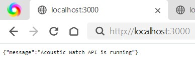
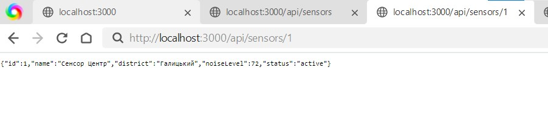
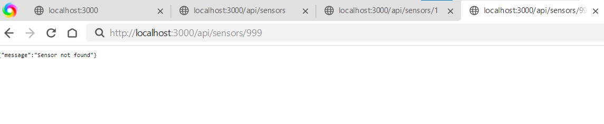
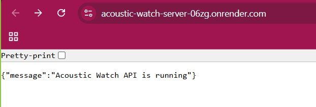

## Звіт з лабораторної роботи №10
**з дисципліни «Веб-програмування»**

**Тема:** Створення серверного застосунку на Node.js  
**Студентка:** Гащук Юлія Володимирівна (група КН-41)  
**Проєкт:** «Акустична варта» (`acoustic-watch-server`)

---

## 1. Мета роботи
Навчитися створювати простий серверний застосунок на базі Node.js та фреймворку Express, налаштовувати ES-модулі та npm-скрипти у `package.json`, реалізовувати базові маршрути API (отримання всіх датчиків, отримання датчика за `id` та обробку статусу `404`), публікувати код у репозиторій GitHub і розгортати вебсервіс на платформі Render.

---

## 2. Хід виконання та опис реалізації
1. Підготовлено структуру серверного застосунку `acoustic-watch-server` (`package.json`, `.gitignore`, `src/data/sensors.js`, `src/server.js`).
2. У файлі `package.json` увімкнено ES-модулі (`"type": "module"`), додано залежність `express` та налаштовано скрипти `"start"` (`node src/server.js`) і `"dev"` (`node --watch src/server.js`).
3. У файлі `src/data/sensors.js` сформовано масив даних про акустичні датчики по районах міста.
4. У файлі `src/server.js` реалізовано Express-сервер на порту `process.env.PORT || 3000` із маршрутами:
   - `GET /` — перевірка стану сервісу;
   - `GET /api/sensors` — повернення списку всіх датчиків;
   - `GET /api/sensors/:id` — пошук датчика за ідентифікатором або повернення статусу `404`, якщо запис не знайдено.
5. Перевірено роботу сервера локально, зафіксовано зміни в репозиторії `web-programming` на GitHub та розгорнуто сервіс на Render за адресою `https://acoustic-watch-server-06zg.onrender.com`.

---

## 3. Результати виконання та скріншоти

### Скріншот 1 — Перевірка головного маршруту локально (`localhost:3000`)

### Скріншот 2 — Отримання списку всіх датчиків (`localhost:3000/api/sensors`)

### Скріншот 3 — Отримання датчика за ідентифікатором (`localhost:3000/api/sensors/1`)

### Скріншот 4 — Обробка неіснуючого датчика (`localhost:3000/api/sensors/999`)

### Скріншот 5 — Робота розгорнутого застосунку на Render

---

## 4. Відповіді на контрольні запитання

### 1. Для чого Node.js потрібний у цій лабораторній роботі?
Node.js дозволяє виконувати JavaScript на стороні сервера, створювати HTTP-сервер, працювати з модулями та керувати залежностями через npm.

### 2. Що спрощує Express у порівнянні зі створенням HTTP-сервера вручну?
Express спрощує опис маршрутів (`app.get`), доступ до параметрів запиту (`req.params`), відправлення JSON-відповідей (`res.json`), керування HTTP-статусами (`res.status(404)`) та підключення middleware без написання громіздкого коду поверх стандартного модуля `http`.

### 3. Що таке маршрут і з яких двох частин його зручно описувати?
Маршрут визначає, як сервер обробляє запит клієнта. Його зручно описувати двома частинами: **HTTP-методом** (наприклад, `GET`) та **шляхом / URL-шаблоном** (наприклад, `/api/sensors` або `/api/sensors/:id`).

### 4. Для чого потрібний `package.json`?
Файл `package.json` містить метадані проєкту, налаштування модулів (наприклад, `"type": "module"`), команди запуску в блоці `"scripts"` (`start`, `dev`) та список залежностей (зокрема `express`).

### 5. Яка різниця між `npm start` та `npm run dev` у нашому проєкті?
Команда `npm start` запускає сервер у звичайному режимі (`node src/server.js`), а `npm run dev` запускає його з `--watch` для автоматичного перезапуску сервера при зміні файлів під час розробки.

### 6. Що означає HTTP-код `404` у маршруті `/api/sensors/:id`?
Код `404` (`Not Found`) означає, що запит дійшов до сервера, але датчика із зазначеним `id` немає в наявних даних, тому сервер повертає статус `404` та повідомлення про помилку.

### 7. Навіщо використовувати `process.env.PORT`, а не тільки число `3000`?
Хмарні платформи (як-от Render) призначають порт через змінну оточення `PORT`. Використання `process.env.PORT || 3000` дає змогу сервісу коректно працювати як на Render, так і локально на порту `3000`.

### 8. Чим `localhost` відрізняється від URL сервера на Render?
`localhost` звертається до сервера, запущеного локально на власному комп'ютері, тоді як URL на Render (`https://...onrender.com`) веде на публічний хмарний застосунок, доступний через інтернет.

### 9. Що відбувається після `git push` у гілку `main`, якщо на Render увімкнений Auto-Deploy?
Render отримує сповіщення про новий коміт у гілці `main`, автоматично підтягує оновлення з GitHub, виконує встановлення залежностей/збірку та перезапускає сервіс з актуальною версією коду.

---

## 5. Висновки
Під час виконання лабораторної роботи №10 розроблено серверний застосунок на базі Node.js та Express для проєкту «Акустична варта», реалізовано маршрути отримання даних про датчики та обробку помилки `404`, перевірено локальну роботу сервера й виконано розгортання на Render.