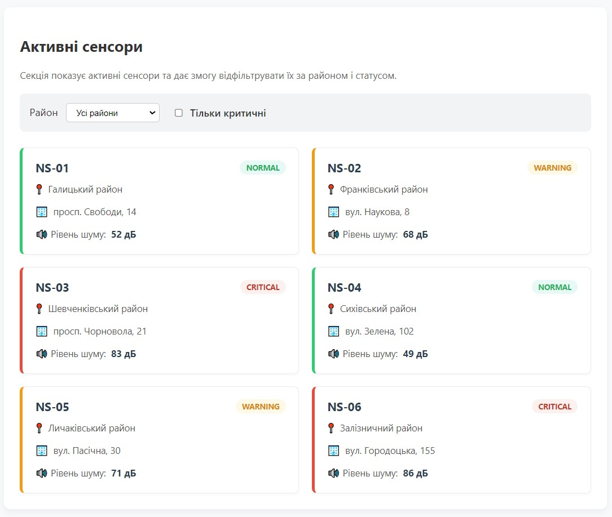
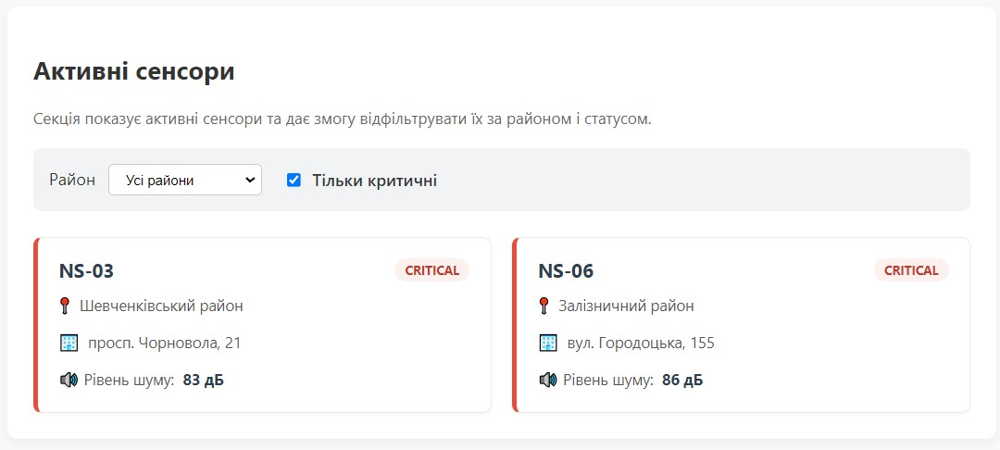

# Звіт з лабораторної роботи №6

**з дисципліни «Веб-програмування»**

**Тема:** Відображення та фільтрація сенсорів у DOM  
**Студентка:** Гащук Юлія Володимирівна (група КН-41)  

## 1. Мета роботи
Навчитися динамічно відображати дані сенсорів на вебсторінці «Акустична варта» за допомогою DOM API (`createElement`, `append`, `replaceChildren`), а також реалізувати комбіновану фільтрацію даних за районом і статусом за допомогою методу `filter()` та обробника подій `change`.

## 2. Відповіді на контрольні питання

1. **Для чого використовується `document.querySelector()`?**  
   Для пошуку та повернення першого елемента документа, який відповідає заданому CSS-селектору.
2. **Що робить `document.createElement()`?**  
   Створює новий елемент із заданим тегом у пам'яті.
3. **Для чого потрібна властивість `textContent`?**  
   Для безпечного зчитування або встановлення текстового вмісту всередині DOM-елемента.
4. **Навіщо перед повторним відображенням очищувати `.sensor-list`?**  
   Щоб уникнути дублювання карток при кожній зміні фільтрів.
5. **Що повертає метод `filter()`?**  
   Новий масив із елементами, які пройшли перевірку у колбек-функції.
6. **Як отримати вибране значення з `select`?**  
   Через властивість `.value`.
7. **Як перевірити, чи `checkbox` увімкнений?**  
   За допомогою булевої властивості `.checked`.
8. **Чому після зміни фільтра потрібно знову викликати `renderSensors`?**  
   Щоб оновити вміст екрана відповідно до нових умов.

## 3. Результати виконання та скріншоти

### Скріншот 1: Відображення всіх активних сенсорів
На скріншоті показано початковий стан секції «Активні сенсори» після завантаження сторінки через локальний сервер.

*Рис. 1. Генерація карток сенсорів із різними статусами за допомогою JavaScript.*

### Скріншот 2: Фільтрація сенсорів за районом і статусом
На скріншоті продемонстровано результати роботи фільтрів (активація чекбокса «Тільки критичні»).

*Рис. 2. Динамічне оновлення списку карток за допомогою методу filter() та події change.*

## 4. Посилання на роботу

* **Опублікована сторінка на GitHub Pages:** [Лабораторна робота №6](https://yuhashchuk2023-5767.github.io/web-programming/lab_6/)
* **Репозиторій проєкту:** [GitHub Repository](https://github.com/yuhashchuk2023-5767.github.io/web-programming/tree/main/lab_6)