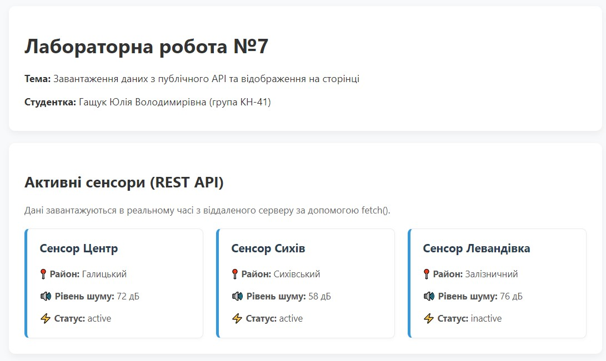
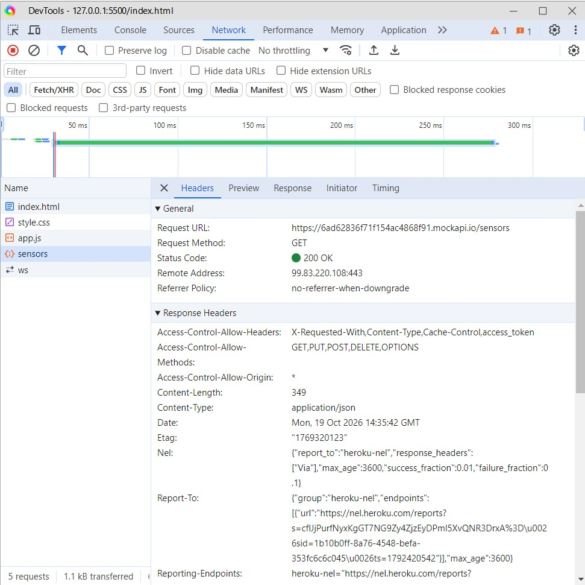

# Звіт з лабораторної робот №7

**з дисципліни «Веб-програмування»**

**Тема:** Завантаження даних з публічного API та відображення на сторінці  
**Студентка:** Гащук Юлія Володимирівна (група КН-41)  

---

## 1. Мета роботи
Навчитися виконувати HTTP GET-запити за допомогою `fetch()`, працювати з асинхронними операціями (`async/await`), обробляти об'єкти `Response`, перетворювати JSON-відповідь у масив JavaScript-об'єктів та динамічно відображати отримані дані в існуючому інтерфейсі вебпроєкту «Акустична варта».

---

## 2. Відповіді на контрольні питання

1. **Що таке API?**  
   Це програмний інтерфейс, який дозволяє одній програмі взаємодіяти з іншою або отримувати дані з віддаленого сервера.
2. **Що таке endpoint?**  
   Конкретна URL-адреса (кінцева точка), за якою сервіс приймає запити для надання певних даних чи виконання операцій.
3. **Для чого використовується HTTP GET?**  
   Для отримання (зчитування) даних із сервера без зміни їхнього стану.
4. **Що повертає `fetch()`?**  
   Promise, який вирішується об'єктом `Response`, що представляє відповідь на запит.
5. **Що знаходиться у змінній `response` після `await fetch()`?**  
   Об'єкт відповіді сервера (`Response`), який містить метадані (статус, заголовок, `ok`), а не самі дані у форматі JSON.
6. **Для чого використовується `response.json()`?**  
   Для зчитування тіла відповіді та перетворення його з формату JSON у звичайний JavaScript-масив чи об'єкт.
7. **Чому в типовому GET-запиті використовуються два `await`?**  
   Перший `await` чекає на отримання HTTP-відповіді від сервера, а другий — на повне зчитування та парсинг тіла відповіді у формат JSON.
8. **Що означає `response.ok`?**  
   Булеве значення, яке дорівнює `true`, якщо HTTP-статус відповіді знаходиться в діапазоні успішних від 200 до 299.
9. **Де у DevTools можна побачити HTTP-запит?**  
   У вкладці **Network** (Мережа) під час перезавантаження сторінки.
10. **Для чого потрібен `try/catch`?**  
    Для перехоплення та обробки помилок виконання коду (наприклад, проблем з мережею або збоїв сервера).

---

## 3. Результати виконання та скріншоти

### Скріншот 1: Відображення даних із MockAPI на сторінці
На скріншоті показано успішне завантаження карток сенсорів, отриманих через `fetch()` із віддаленого REST API.

### Скріншот 2: Перевірка GET-запиту у вкладці Network (DevTools)
На скріншоті зафіксовано успішний HTTP-запит (`GET 200 OK`) до ресурсу `sensors`.

## 4. Посилання на роботу

* **Опублікована сторінка на GitHub Pages:** [Лабораторна робота №7](https://yuhashchuk2023-5767.github.io/web-programming/lab_7/)
* **Репозиторій проєкту:** [GitHub Repository](https://github.com/yuhashchuk2023-5767.github.io/web-programming/tree/main/lab_7)