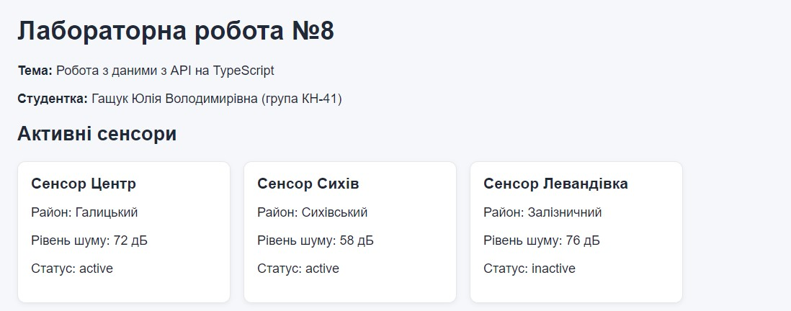
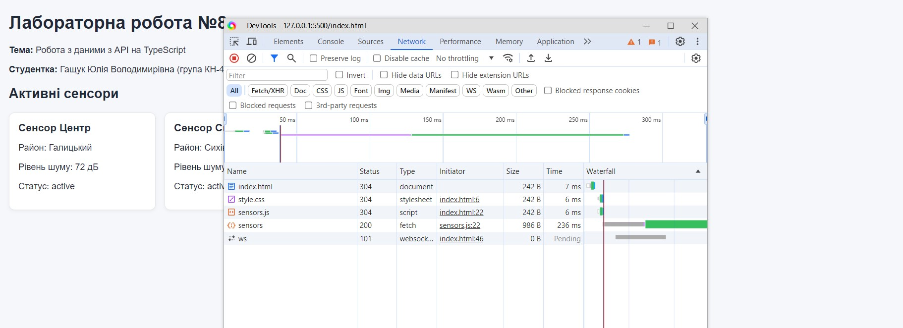

# Звіт з лабораторної роботи №8
**з дисципліни «Веб-програмування»**

**Тема:** Робота з даними з API на TypeScript  
**Студентка:** Гащук Юлія Володимирівна (група КН-41)

---

### 1. Мета роботи
Навчитися описувати структуру даних із REST API за допомогою `interface` у TypeScript, виконувати асинхронні HTTP GET-запити через `fetch()` та `async/await`, типізувати масиви об'єктів (`Sensor[]`), компілювати TypeScript-код (`src/sensors.ts`) у JavaScript (`dist/sensors.js`) та динамічно відображати отримані дані на HTML-сторінці проєкту «Акустична варта».

---

### 2. Хід виконання та опис реалізації
1. Ініціалізовано проєкт за допомогою `npm init -y`, встановлено компілятор TypeScript (`npm install -D typescript`) та налаштовано файл конфігурації `tsconfig.json` із вхідною директорією `./src` та вихідною `./dist`.
2. У файлі `src/sensors.ts` створено інтерфейс `Sensor`, який описує типізовану структуру даних сенсора (`id`, `name`, `district`, `noiseLevel`, `status: "active" | "inactive"`).
3. Реалізовано асинхронну функцію `loadSensors(): Promise<void>`, яка отримує дані з MockAPI через `fetch()`, перевіряє статус відповіді (`response.ok`), перетворює JSON у масив `Sensor[]` та передає його у функцію рендерингу.
4. Реалізовано функцію `renderSensors(sensors: Sensor[]): void`, яка перевіряє наявність контейнера `#sensors` (`HTMLDivElement`) та генерує HTML-картки для кожного сенсора.
5. Виконано компіляцію коду командою `npx tsc` та підключено згенерований модуль `./dist/sensors.js` до `index.html`.

---

### 3. Результати виконання та скріншоти

* **Скріншот 1: Відображення типізованих даних із MockAPI на сторінці**  
    

* **Скріншот 2: Перевірка мережевого запиту у вкладці Network (DevTools)**  
    
  

---

### 4. Посилання на роботу
* **Опублікована сторінка на GitHub Pages:** [Лабораторна робота №8](https://yuhashchuk2023-5767.github.io/web-programming/lab_8/)
* **Репозиторій проєкту:** [GitHub Repository](https://github.com/yuhashchuk2023-5767/web-programming/tree/main/lab_8)