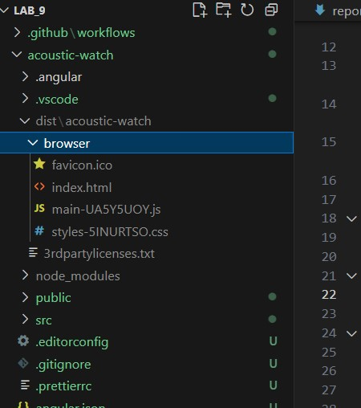
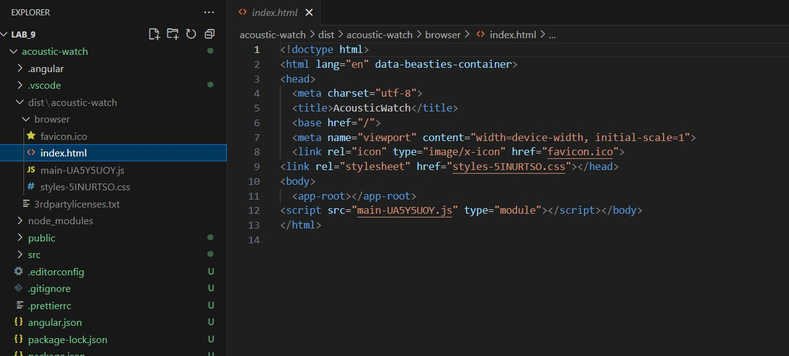
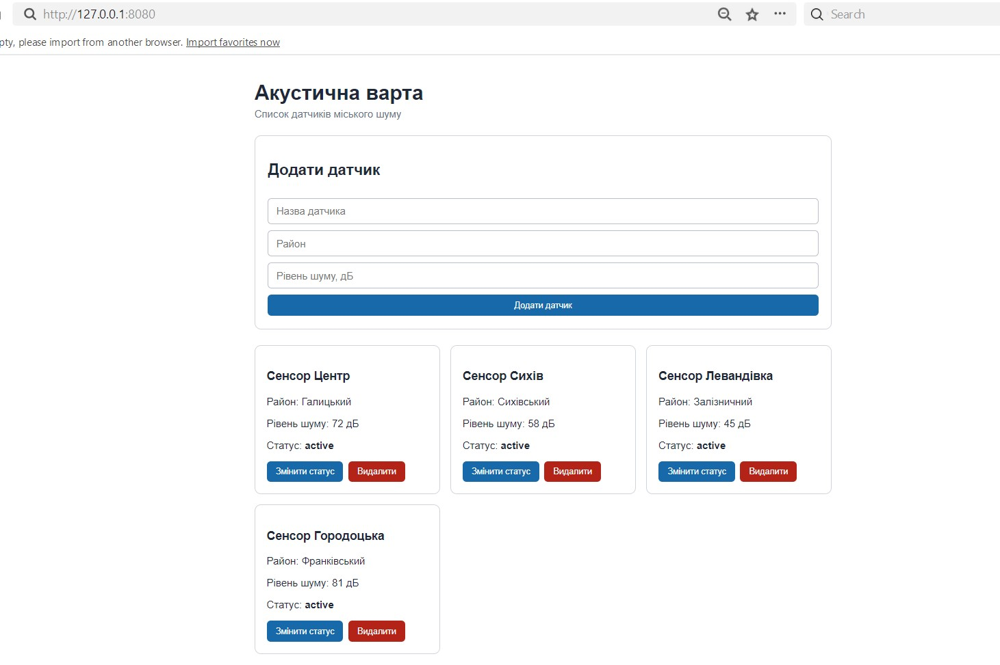

# Звіт з лабораторної роботи №9

**з дисципліни «Веб-програмування»**

**Тема:** Створення простого Angular-застосунку («Todo list»)
**Студентка:** Гащук Юлія Володимирівна (група КН-41)

Проєкт: «Акустична варта» (acoustic-watch)

### 1. Мета роботи
Навчитися створювати простий Angular-застосунок у форматі standalone, описувати модель даних через interface, відображати списки за допомогою @for, обробляти дії користувача (додавання датчика, перемикання статусу active / inactive, видалення), виконувати production-збірку (ng build), перевіряти її через локальний HTTP-сервер та публікувати застосунок через GitHub Pages.

### 2. Хід виконання та опис реалізації
1. Перевірено версії Node.js та npm, глобально встановлено Angular CLI та створено standalone-застосунок без маршрутизації, unit-тестів, SSR і SSG командою ng new acoustic-watch --routing=false --style=css --skip-tests.
2. У файлі src/app/sensor.ts створено інтерфейс Sensor із полями id, name, district, noiseLevel та status ("active" | "inactive").
3. У файлі src/app/app.ts реалізовано компонент App із початковим списком датчиків («Сенсор Центр», «Сенсор Сихів», «Сенсор Левандівка»), полями форми та методами addSensor(), toggleStatus(id) і deleteSensor(id).
4. У файлах src/app/app.html та src/app/app.css створено форму додавання датчика з двосторонньою прив'язкою [(ngModel)], виведення карток через @for (sensor of sensors; track sensor.id) із класом [class.inactive]="sensor.status === 'inactive'" та візуальне оформлення інтерфейсу.
5. Перевірено роботу застосунку у режимі розробки (ng serve --open), виконано production-збірку командою ng build та перевірено зібрані файли через локальний HTTP-сервер (npx http-server dist/acoustic-watch/browser).

### 3. Результати виконання та скріншоти
- Скріншот 1 : Папка dist/acoustic-watch/browser.

- Скріншот 2 : Файл dist/acoustic-watch/browser/index.html.

- Скріншот 3 : Зібрана production-версія застосунку на http://127.0.0.1:8080 із доданим датчиком «Сенсор Городоцька».

### 4. Відповіді на контрольні запитання
1. Що таке Angular? — Це фреймворк на базі TypeScript для створення вебзастосунків (зокрема SPA) із компонентною архітектурою, шаблонами, формами та інструментами збірки.
2. Для чого потрібен Angular CLI? — Це інтерфейс командного рядка (ng), який автоматизує створення проєкту, генерацію коду, запуск локального сервера розробки та збірку застосунку.
3. Що робить команда ng new? — Створює новий Angular-проєкт із базовою структурою директорій, файлів конфігурації та встановленими залежностями.
4. Для чого використовується ng serve? — Запускає локальний сервер розробки, компілює застосунок у пам'яті та автоматично оновлює сторінку в браузері при зміні файлів.
5. Що таке компонент Angular? — Це основний будівельний блок інтерфейсу, який об'єднує логіку (клас TypeScript), HTML-шаблон і стилі та керує певною частиною сторінки.
6. Що робить @for у шаблоні? — Керуюча конструкція шаблону Angular, яка перебирає елементи масиву або колекції та рендерить блок розмітки для кожного елемента.
7. Для чого потрібен track sensor.id? — Дозволяє Angular ефективно відстежувати кожен елемент списку за унікальним ідентифікатором (sensor.id) під час оновлення, додавання або видалення карток.
8. Чим ng serve відрізняється від ng build? — ng serve запускає локальний сервер для розробки зі стеженням за змінами в пам'яті, а ng build створює оптимізовані статичні файли для розгортання та публікації.
9. Для чого створюється папка dist? — У ній зберігаються зібрані production-файли застосунку (HTML, JS, CSS та інші ресурси), готові для розміщення на вебсервері або хостингу (наприклад, GitHub Pages).

### 5. Висновки
Під час виконання лабораторної роботи створено standalone Angular-застосунок «Акустична варта» з типізованою моделлю Sensor, формою додавання датчиків, рендерингом списку через @for, керуванням статусами та видаленням. Виконано production-збірку (ng build), перевірено її через локальний HTTP-сервер та підготовлено публікацію на GitHub Pages.

### 6. Посилання на роботу
* **Опублікована сторінка на GitHub Pages:** [Лабораторна робота №9](https://yuhashchuk2023-5767.github.io/web-programming/lab_9/)
* **Репозиторій проєкту:** [GitHub Repository](https://github.com/yuhashchuk2023-5767/web-programming/tree/main/lab_9)